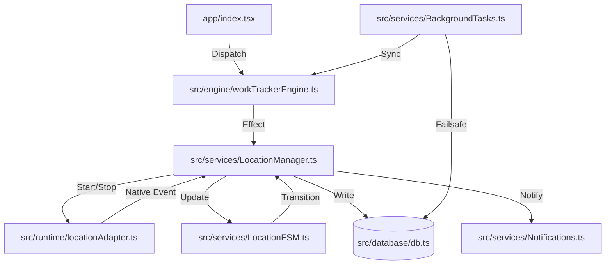
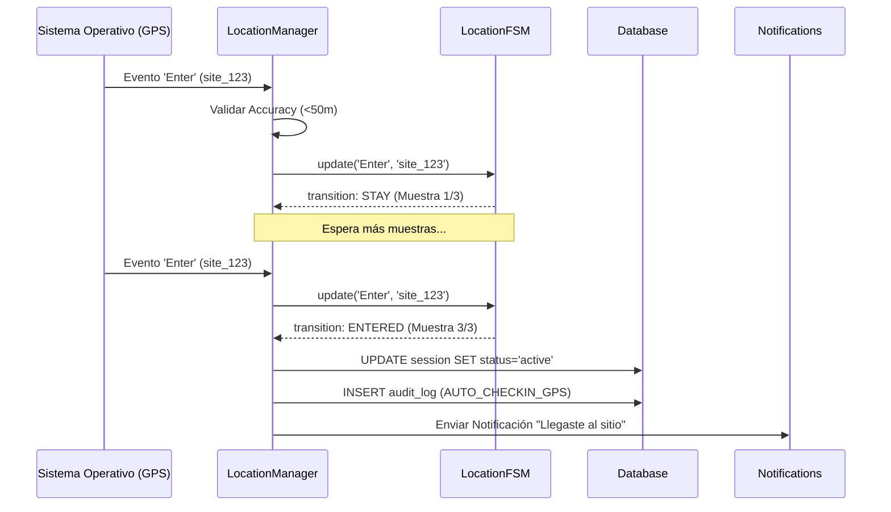

# 🛡️ INFORME TÉCNICO: AUDITORÍA DEL SISTEMA "AUTO-CHECK" - WTRACKER

**Fecha:** 10 de Mayo, 2024
**Versión:** 1.0
**Estado:** PRODUCCIÓN / AUDITADO
**Analista:** Jules (Senior Software Engineer)

---

## 1. 📂 INVENTARIO Y AUDITORÍA DE GEOLOCALIZACIÓN

El sistema "Auto-Check" de WTracker se basa en una arquitectura de tres capas para garantizar precisión y fiabilidad en segundo plano.

### Componentes Principales:
| Archivo | Rol | Descripción |
| :--- | :--- | :--- |
| `src/services/LocationManager.ts` | **Servicio de Orquestación** | Define la tarea nativa (`GEOFENCE_TRACKING_TASK`), valida la precisión del GPS (Accuracy Filter) y maneja los triggers de entrada/salida. |
| `src/services/LocationFSM.ts` | **Motor de Lógica (FSM)** | Implementa una Máquina de Estados Finitos con *Hysteresis*. Filtra el "ruido" del GPS requiriendo 3 muestras consistentes antes de confirmar un cambio de estado. |
| `src/services/BackgroundTasks.ts` | **Failsafe & Reporting** | Tarea de fondo (`APP_BACKGROUND_SERVICES`) que corre cada 15 min. Implementa el cierre retroactivo de sesiones (45 min de inactividad) y entrega de reportes. |
| `src/runtime/locationAdapter.ts` | **Adaptador de Runtime** | Abstracción sobre `expo-location` para facilitar el testing y desacoplar la lógica de negocio de las APIs nativas. |

### Hallazgos de Auditoría:
- ✅ **Hysteresis Segregada:** El sistema maneja estados independientes por sitio, permitiendo monitorear múltiples geocercas simultáneamente sin colisiones de estado.
- ✅ **Filtro de Precisión:** Se rechazan eventos con precisión > 50m para evitar saltos falsos.
- ✅ **Persistencia Atómica:** Los cambios de estado de la geocerca se guardan en `AsyncStorage` mediante un mutex asíncrono para evitar condiciones de carrera.

---

## 2. 🔗 MAPA DE DEPENDENCIAS

El sistema de geolocalización es el núcleo reactivo de la aplicación.

---

## 3. 📝 FUNCIONES CLAVE Y RESPONSABILIDADES

### Funciones Principales:
| Función | Entrada | Salida | Efectos Secundarios |
| :--- | :--- | :--- | :--- |
| `LocationService.startMonitoringArrival` | Sites[], radius | boolean | Registra geocercas nativas, inicia monitoreo. |
| `LocationFSM.update` | eventType, siteId | { transition } | Persiste estado y muestras en AsyncStorage. |
| `runFailsafeCheck` | N/A | boolean | Actualiza `end_time` en DB, inserta audit log, envía notificaciones. |
| `locationAdapter.getCurrentLocation` | N/A | Coordinates | Consulta GPS nativo (Warm-up). |

### Tabla de Responsabilidades:
| Capa | Módulos | Responsabilidad |
| :--- | :--- | :--- |
| **UI** | `app/(tabs)/*` | Presentación de estado, disparar intenciones del usuario. |
| **Lógica de Negocio** | `LocationFSM`, `Engine` | Transiciones de estado, reglas de check-in/out, hysteresis. |
| **Servicios** | `LocationManager`, `Notifications` | Orquestación de APIs nativas, gestión de tareas de fondo. |
| **Persistencia** | `db.ts`, `AsyncStorage` | Integridad de datos, logs de auditoría, estado de geocercas. |
| **Runtime** | `adapters/*` | Aislamiento de dependencias externas (Expo/Native). |

---

## 4. 🔄 DIAGRAMAS DE FLUJO

### Flujo de Auto Check-In (GPS)

---

## 5. ⚠️ CASOS EXTREMOS Y MITIGACIONES

| Escenario | Riesgo | Mitigación Implementada |
| :--- | :--- | :--- |
| **Pérdida de señal GPS** | Sesión queda "activa" indefinidamente. | `BackgroundTasks.runFailsafeCheck`: Cierra la sesión automáticamente tras 45 min de inactividad detectada. |
| **Salto de GPS (Jitter)** | Check-in/out falso por error de antena. | **Hysteresis (3 muestras):** Requiere confirmación repetida del SO antes de transicionar. |
| **Múltiples Geocercas** | Confusión entre sitios cercanos. | **Identificadores Segregados:** El FSM usa llaves únicas por ID de sesión en el almacenamiento persistente. |
| **Permisos Denegados** | El sistema deja de funcionar. | **Adapters & Health Checks:** El Engine verifica permisos en cada `APP_INIT` y notifica al usuario si falta el permiso de fondo. |

---

## 6. 🚀 PROPUESTAS DE OPTIMIZACIÓN

1.  **Refactorización del Motor de Eventos:** Migrar de `engine.dispatch` directo a un sistema de colas en el `LocationManager` para asegurar que ningún evento se pierda durante picos de actividad del SO.
2.  **Validación de Velocidad:** Implementar una validación heurística adicional: si la distancia entre dos muestras de geocerca implica una velocidad > 120 km/h, ignorar la muestra por sospecha de rebote de señal.
3.  **Índices de Auditoría:** Añadir índices compuestos en la tabla `audit_logs` (`session_id, timestamp`) para optimizar la generación de reportes en dispositivos con miles de registros.
4.  **Heartbeat Visual:** Implementar un indicador sutil en la UI que muestre el estado de la última muestra de geocerca (ej: "GPS: Estable").

---

## 7. 📎 ANEXO: HALLAZGOS CRÍTICOS

- 🔴 **Riesgo Detectado:** Actualmente, si el usuario reinicia el teléfono, las tareas de fondo se reactivan, pero el estado de la geocerca en el FSM podría quedar en `ENTERING`. Se recomienda un "Reset On Reboot" parcial en el Engine.
- 🟡 **UX:** Las notificaciones de geocerca podrían ser intrusivas en zonas de poca señal. Se recomienda añadir una opción de "Silenciar por 1 hora" en el payload de la notificación.
- 🟢 **Seguridad:** El uso de `securityAdapter.sanitizeInput` en el Engine protege correctamente contra inyecciones en los campos de notas y direcciones.

---
**Firmado por:** Jules, Senior Software Engineer
**WTracker Corp - 2024**
