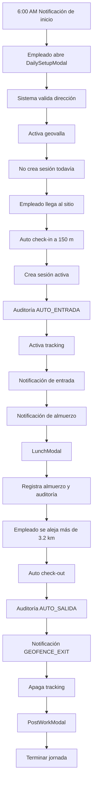

## 1. Lógica de negocio principal

La lógica de negocio central es:

> **Registrar automáticamente la entrada y salida laboral de un empleado según su ubicación física, permitiendo uno o varios trabajos en el mismo día, con auditoría completa y tolerancia a condiciones reales como internet ausente, GPS débil o dirección incorrecta.**

El ciclo completo gira alrededor de estos conceptos:

1. **El empleado define a dónde va a trabajar.**
   - Recibe una notificación de inicio de jornada: “¿A dónde vas a trabajar hoy?”
   - Al tocarla se abre `DailySetupModal`.
   - Ingresa o confirma la dirección del trabajo.
   - El sistema valida la dirección, activa la geovalla y todavía **no crea sesión** ni registra auditoría. [1](https://onedrive.live.com?cid=2B17E092BC9523F4&id=2B17E092BC9523F4!sb06b38cb90c742609aea48f2ebbea20b)

2. **La sesión laboral se crea solamente cuando el empleado llega al sitio.**
   - Cuando cruza el radio de 150 m, ocurre el auto check-in.
   - El sistema crea una sesión activa, registra auditoría `AUTO_ENTRADA`, activa tracking y envía una notificación de entrada registrada. [1](https://onedrive.live.com?cid=2B17E092BC9523F4&id=2B17E092BC9523F4!sb06b38cb90c742609aea48f2ebbea20b)

3. **El almuerzo se registra como evento dentro de la jornada.**
   - A mediodía se envía una notificación: “¿Vas a tomar tu hora de lonche?”
   - Al tocarla se abre `LunchModal`.
   - El sistema marca si tomó o no tomó almuerzo y registra auditoría. [1](https://onedrive.live.com?cid=2B17E092BC9523F4&id=2B17E092BC9523F4!sb06b38cb90c742609aea48f2ebbea20b)

4. **La salida se detecta automáticamente por distancia.**
   - Si el empleado se aleja más de 3.2 km, el sistema hace auto check-out.
   - Cierra la sesión, registra auditoría `AUTO_SALIDA`, envía una notificación con `type: 'GEOFENCE_EXIT'` y apaga tracking. [1](https://onedrive.live.com?cid=2B17E092BC9523F4&id=2B17E092BC9523F4!sb06b38cb90c742609aea48f2ebbea20b)

5. **Después de salir, el empleado decide si termina el día o va a otro trabajo.**
   - Al tocar la notificación de salida se abre `PostWorkModal`.
   - Puede elegir:
     - **Terminar jornada**
     - **Nuevo trabajo**, lo cual vuelve a abrir `DailySetupModal`. [1](https://onedrive.live.com?cid=2B17E092BC9523F4&id=2B17E092BC9523F4!sb06b38cb90c742609aea48f2ebbea20b)

---

## 2. Entidades de negocio necesarias

A partir del archivo, el sistema necesita manejar estas entidades:

### A. Empleado

Representa al usuario que trabaja durante el día.

Debe tener relación con:

- Jornadas.
- Sesiones laborales.
- Direcciones de trabajo.
- Eventos de auditoría.
- Decisiones manuales en modales.

### B. Jornada diaria

Representa el día laboral completo.

Puede contener:

- Cero, una o varias sesiones de trabajo.
- Uno o varios sitios.
- Registro de almuerzo.
- Estado final: jornada terminada o pendiente.

### C. Sesión laboral

Es el bloque real de trabajo en un sitio.

Debe contener como mínimo:

- Dirección ingresada.
- Coordenadas usadas para geovalla.
- Hora de entrada.
- Hora de salida.
- Método de entrada: auto por geocerca.
- Método de salida: auto por alejamiento.
- Estado: pendiente, activa, cerrada.
- Si corresponde, dirección real obtenida por reverse geocoding.

El archivo muestra que un día puede tener una sesión, dos sesiones o incluso volver al mismo sitio después de salir temporalmente. [1](https://onedrive.live.com?cid=2B17E092BC9523F4&id=2B17E092BC9523F4!sb06b38cb90c742609aea48f2ebbea20b)

### D. Sitio de trabajo

Representa la dirección o ubicación laboral.

Debe permitir:

- Dirección escrita por el usuario.
- Coordenadas geocodificadas.
- Coordenadas fallback por GPS.
- Coordenadas `0,0` como último recurso si todo falla.
- Reutilización de la misma dirección para volver al mismo sitio. [1](https://onedrive.live.com?cid=2B17E092BC9523F4&id=2B17E092BC9523F4!sb06b38cb90c742609aea48f2ebbea20b)

### E. Auditoría

Es obligatoria para eventos críticos.

Eventos explícitos en el archivo:

- `AUTO_ENTRADA`
- `AUTO_SALIDA`
- Auditoría de almuerzo
- Auditoría general cuando se marca almuerzo tomado o no tomado [1](https://onedrive.live.com?cid=2B17E092BC9523F4&id=2B17E092BC9523F4!sb06b38cb90c742609aea48f2ebbea20b)

### F. Notificaciones

Son parte del flujo de negocio, no solo UI.

Tipos relevantes:

- Inicio de jornada.
- Almuerzo.
- Entrada registrada.
- Salida registrada con `type: 'GEOFENCE_EXIT'`. [1](https://onedrive.live.com?cid=2B17E092BC9523F4&id=2B17E092BC9523F4!sb06b38cb90c742609aea48f2ebbea20b)

---

## 3. Sistemas y servicios requeridos

Según los flujos descritos, la app necesita estos sistemas o servicios.

## A. Servicio de notificaciones

Necesario para:

- Preguntar al empleado a dónde va a trabajar.
- Preguntar sobre el almuerzo.
- Confirmar entrada registrada.
- Confirmar salida registrada.
- Abrir el modal correcto al tocar la notificación.

Debe soportar notificaciones con payload, especialmente:

```ts
type: 'GEOFENCE_EXIT'
```

Ese tipo permite que al tocar la notificación de salida se abra `PostWorkModal`. [1](https://onedrive.live.com?cid=2B17E092BC9523F4&id=2B17E092BC9523F4!sb06b38cb90c742609aea48f2ebbea20b)

---

## B. Servicio de geocoding

Necesario para convertir la dirección ingresada en coordenadas.

Debe operar con lógica online/offline:

1. Si hay internet:
   - Geocodifica la dirección.
2. Si no hay internet:
   - No puede geocodificar.
   - Usa GPS actual como fallback.
3. Si GPS también falla:
   - Usa `0,0`.
4. En todos los casos:
   - Guarda la dirección tal cual.
   - Activa geovalla con lo que tenga. [1](https://onedrive.live.com?cid=2B17E092BC9523F4&id=2B17E092BC9523F4!sb06b38cb90c742609aea48f2ebbea20b)

---

## C. Servicio de reverse geocoding

Necesario cuando la dirección original era incorrecta pero el GPS funciona.

El archivo indica que si la dirección era incorrecta y el GPS funciona:

- El auto check-in ocurre igual.
- El sistema usa reverse geocoding para obtener la dirección real.
- Registra auditoría `AUTO_ENTRADA`. [1](https://onedrive.live.com?cid=2B17E092BC9523F4&id=2B17E092BC9523F4!sb06b38cb90c742609aea48f2ebbea20b)

---

## D. Servicio de geofencing

Es uno de los servicios más importantes.

Debe manejar:

- Activación de geovalla al configurar dirección.
- Entrada cuando el empleado cruza un radio de 150 m.
- Reactivación de geovalla si el empleado elige “Nuevo trabajo”.
- Reactivación incluso si el nuevo trabajo es la misma dirección.
- Operación con app cerrada. [1](https://onedrive.live.com?cid=2B17E092BC9523F4&id=2B17E092BC9523F4!sb06b38cb90c742609aea48f2ebbea20b)

Regla clave:

```txt
Entrada automática = empleado cruza radio de 150 m
```

---

## E. Servicio de tracking GPS activo

Se activa después del check-in y se apaga después del check-out.

Debe detectar alejamiento mayor a 3.2 km.

Regla clave:

```txt
Salida automática = distancia desde sitio > 3.2 km
```

Cuando eso ocurre:

- Cierra sesión.
- Registra `AUTO_SALIDA`.
- Envía notificación `GEOFENCE_EXIT`.
- Apaga tracking. [1](https://onedrive.live.com?cid=2B17E092BC9523F4&id=2B17E092BC9523F4!sb06b38cb90c742609aea48f2ebbea20b)

---

## F. Servicio de sesiones laborales

Debe crear, mantener y cerrar sesiones.

Reglas importantes:

- No crear sesión al ingresar dirección.
- Crear sesión solamente en auto check-in.
- Solo debe existir una sesión activa a la vez.
- Cerrar la sesión en auto check-out.
- Permitir varias sesiones en el mismo día.
- Permitir nueva sesión en la misma dirección.
- Guardar sesiones completas para auditoría y reporte. [1](https://onedrive.live.com?cid=2B17E092BC9523F4&id=2B17E092BC9523F4!sb06b38cb90c742609aea48f2ebbea20b)

---

## G. Servicio de auditoría

Debe registrar eventos de negocio importantes.

El archivo exige auditoría para:

- Entrada automática.
- Salida automática.
- Almuerzo.
- Decisiones relevantes del sistema. [1](https://onedrive.live.com?cid=2B17E092BC9523F4&id=2B17E092BC9523F4!sb06b38cb90c742609aea48f2ebbea20b)

Debe ser tolerante a offline, porque el archivo aclara que almuerzo y auto check-out funcionan aunque no haya internet. [1](https://onedrive.live.com?cid=2B17E092BC9523F4&id=2B17E092BC9523F4!sb06b38cb90c742609aea48f2ebbea20b)

---

## H. Persistencia local

Aunque el archivo no menciona una tecnología específica, sí exige comportamiento offline. Por lo tanto, como diseño sugerido, el sistema debería tener almacenamiento local para:

- Dirección ingresada.
- Coordenadas calculadas o fallback.
- Estado de geovalla.
- Sesión activa.
- Auditoría pendiente.
- Almuerzo tomado/no tomado.
- Eventos de entrada y salida.

Esto es una recomendación técnica derivada del requerimiento de operar sin internet, no una tecnología explícitamente nombrada en el archivo.

---

## I. Servicio de sincronización

El archivo no especifica backend ni sincronización, pero por los casos offline sería recomendable tener un servicio que luego suba:

- Sesiones cerradas.
- Auditorías.
- Eventos de almuerzo.
- Correcciones de dirección real.

Esto también es una recomendación de arquitectura, no un detalle explícito del archivo.

---

## 4. Flujos que debe manejar

## Flujo 1: Día normal con un solo trabajo



Este flujo corresponde a la simulación donde hay una sola sesión, entrada automática, almuerzo y salida automática. [1](https://onedrive.live.com?cid=2B17E092BC9523F4&id=2B17E092BC9523F4!sb06b38cb90c742609aea48f2ebbea20b)

---

## Flujo 2: Día con dos trabajos

El sistema debe soportar múltiples sesiones en el mismo día.

Secuencia:

1. Empleado configura primer trabajo.
2. Auto check-in del primer trabajo.
3. Almuerzo.
4. Auto check-out del primer trabajo.
5. Toca notificación de salida.
6. Abre `PostWorkModal`.
7. Elige “Nuevo trabajo”.
8. Se abre `DailySetupModal`.
9. Ingresa nueva dirección.
10. Se activa nueva geovalla.
11. Auto check-in del segundo trabajo.
12. Auto check-out del segundo trabajo.
13. Elige “Terminar jornada”. [1](https://onedrive.live.com?cid=2B17E092BC9523F4&id=2B17E092BC9523F4!sb06b38cb90c742609aea48f2ebbea20b)

Regla de negocio importante:

```txt
Una jornada puede tener múltiples sesiones completas.
```

El resultado esperado del día es:

- Dos sesiones completas.
- Dos entradas.
- Dos salidas.
- Almuerzo registrado.
- Auditoría completa. [1](https://onedrive.live.com?cid=2B17E092BC9523F4&id=2B17E092BC9523F4!sb06b38cb90c742609aea48f2ebbea20b)

---

## Flujo 3: Sin internet, GPS débil o dirección incorrecta

Este es el flujo de resiliencia.

### Si no hay internet al ingresar dirección

El sistema debe:

1. Intentar geocodificar.
2. Al fallar, usar GPS actual como fallback.
3. Si GPS también falla, usar `0,0`.
4. Guardar la dirección tal cual.
5. Activar geovalla con la mejor información disponible. [1](https://onedrive.live.com?cid=2B17E092BC9523F4&id=2B17E092BC9523F4!sb06b38cb90c742609aea48f2ebbea20b)

### Si la dirección era incorrecta pero GPS funciona

El sistema debe:

- Permitir auto check-in de todas formas.
- Obtener dirección real usando reverse geocoding.
- Registrar `AUTO_ENTRADA`. [1](https://onedrive.live.com?cid=2B17E092BC9523F4&id=2B17E092BC9523F4!sb06b38cb90c742609aea48f2ebbea20b)

### Si el GPS está débil

El sistema no debe forzar un check-in inválido.

Flujo esperado:

1. No hay auto check-in.
2. El empleado abre la app.
3. Toca “Nuevo trabajo”.
4. Ingresa dirección correcta.
5. Se activa geovalla.
6. Auto check-in ocurre cuando el GPS se estabiliza. [1](https://onedrive.live.com?cid=2B17E092BC9523F4&id=2B17E092BC9523F4!sb06b38cb90c742609aea48f2ebbea20b)

Regla importante:

```txt
GPS débil no debe producir entrada automática falsa.
```

---

## Flujo 4: Salida temporal y regreso al mismo sitio

Este caso es muy importante porque evita asumir que una salida siempre significa fin del día.

Ejemplo del archivo:

1. El empleado entra al sitio normalmente.
2. Se aleja más de 3.2 km para ir a Home Depot.
3. El sistema hace auto check-out.
4. Envía notificación `GEOFENCE_EXIT`.
5. El empleado toca la notificación.
6. Se abre `PostWorkModal`.
7. Elige “Nuevo trabajo”.
8. Ingresa la misma dirección.
9. Se activa geovalla nuevamente.
10. Al regresar, ocurre un nuevo auto check-in.
11. Al salir finalmente, ocurre auto check-out.
12. Elige “Terminar jornada”. [1](https://onedrive.live.com?cid=2B17E092BC9523F4&id=2B17E092BC9523F4!sb06b38cb90c742609aea48f2ebbea20b)

Regla clave:

```txt
Volver al mismo sitio debe crear una nueva sesión si ya hubo auto check-out.
```

---

## 5. Estados principales que debe manejar la app

Una forma clara de modelarlo sería:

```txt
IDLE
  ↓
WAITING_DAILY_SETUP
  ↓
GEOFENCE_ARMED
  ↓
ACTIVE_SESSION
  ↓
SESSION_CLOSED_WAITING_POST_WORK_DECISION
  ↓              ↓
DAY_FINISHED     WAITING_DAILY_SETUP
```

### Estados explicados

#### `IDLE`

No hay sesión activa ni geovalla configurada.

#### `WAITING_DAILY_SETUP`

El sistema ya envió la notificación de inicio o el usuario está por configurar dirección.

#### `GEOFENCE_ARMED`

La dirección ya fue ingresada y la geovalla está activa, pero todavía no existe sesión.

Regla crítica:

```txt
Configurar dirección no equivale a empezar trabajo.
```

#### `ACTIVE_SESSION`

Ya ocurrió auto check-in.

En este estado:

- Hay sesión activa.
- Tracking está prendido.
- Se puede registrar almuerzo.
- Se monitorea distancia para salida.

#### `SESSION_CLOSED_WAITING_POST_WORK_DECISION`

Ya ocurrió auto check-out.

El sistema espera que el empleado decida:

- Terminar jornada.
- Nuevo trabajo.

#### `DAY_FINISHED`

No hay más sesiones activas.

---

## 6. Reglas de negocio importantes

### Regla 1: No crear sesión al configurar dirección

El archivo lo dice explícitamente: después de validar dirección y activar geovalla, el sistema no crea sesión ni registra auditoría. [1](https://onedrive.live.com?cid=2B17E092BC9523F4&id=2B17E092BC9523F4!sb06b38cb90c742609aea48f2ebbea20b)

### Regla 2: Entrada automática por radio de 150 m

El check-in ocurre cuando el empleado cruza el radio de 150 m. [1](https://onedrive.live.com?cid=2B17E092BC9523F4&id=2B17E092BC9523F4!sb06b38cb90c742609aea48f2ebbea20b)

### Regla 3: Salida automática por distancia mayor a 3.2 km

El check-out ocurre cuando el empleado se aleja más de 3.2 km. [1](https://onedrive.live.com?cid=2B17E092BC9523F4&id=2B17E092BC9523F4!sb06b38cb90c742609aea48f2ebbea20b)

### Regla 4: La app debe funcionar aunque esté cerrada

Durante el camino al trabajo, el archivo indica que la app puede estar cerrada y la geovalla sigue activa. [1](https://onedrive.live.com?cid=2B17E092BC9523F4&id=2B17E092BC9523F4!sb06b38cb90c742609aea48f2ebbea20b)

### Regla 5: Offline no debe bloquear toda la jornada

Sin internet:

- No se puede geocodificar.
- Se usa GPS actual como fallback.
- Si GPS falla, se usa `0,0`.
- Almuerzo funciona igual.
- Auto check-out funciona igual. [1](https://onedrive.live.com?cid=2B17E092BC9523F4&id=2B17E092BC9523F4!sb06b38cb90c742609aea48f2ebbea20b)

### Regla 6: Dirección incorrecta no necesariamente bloquea check-in

Si GPS funciona, el sistema puede hacer auto check-in y usar reverse geocoding para obtener la dirección real. [1](https://onedrive.live.com?cid=2B17E092BC9523F4&id=2B17E092BC9523F4!sb06b38cb90c742609aea48f2ebbea20b)

### Regla 7: GPS débil no debe generar eventos automáticos incorrectos

Si GPS es débil, no hay auto check-in hasta que el GPS se estabilice. [1](https://onedrive.live.com?cid=2B17E092BC9523F4&id=2B17E092BC9523F4!sb06b38cb90c742609aea48f2ebbea20b)

### Regla 8: Un día puede tener varias sesiones

El sistema debe soportar dos trabajos o más si el empleado elige “Nuevo trabajo” después de una salida. [1](https://onedrive.live.com?cid=2B17E092BC9523F4&id=2B17E092BC9523F4!sb06b38cb90c742609aea48f2ebbea20b)

### Regla 9: La misma dirección puede reutilizarse

Si el empleado sale temporalmente, por ejemplo a Home Depot, y vuelve al mismo sitio, debe poder crear una nueva sesión con la misma dirección. [1](https://onedrive.live.com?cid=2B17E092BC9523F4&id=2B17E092BC9523F4!sb06b38cb90c742609aea48f2ebbea20b)

---

## 7. Modales necesarios

El archivo menciona tres modales clave.

## `DailySetupModal`

Se usa para:

- Ingresar dirección del trabajo.
- Configurar nuevo trabajo.
- Reactivar geovalla para otro sitio o el mismo sitio. [1](https://onedrive.live.com?cid=2B17E092BC9523F4&id=2B17E092BC9523F4!sb06b38cb90c742609aea48f2ebbea20b)

Debe abrirse desde:

- Notificación de inicio de jornada.
- Opción “Nuevo trabajo” en `PostWorkModal`.

---

## `LunchModal`

Se usa para:

- Confirmar si el empleado tomará o tomó su hora de lonche.
- Registrar almuerzo tomado o no tomado.
- Generar auditoría. [1](https://onedrive.live.com?cid=2B17E092BC9523F4&id=2B17E092BC9523F4!sb06b38cb90c742609aea48f2ebbea20b)

---

## `PostWorkModal`

Se abre después de tocar la notificación de salida.

Opciones:

- **Terminar jornada**
- **Nuevo trabajo** [1](https://onedrive.live.com?cid=2B17E092BC9523F4&id=2B17E092BC9523F4!sb06b38cb90c742609aea48f2ebbea20b)

Es el modal que decide si el día termina o si se prepara otra sesión.

---

## 8. Eventos mínimos del sistema

Una estructura mínima de eventos sería:

```ts
type WorkEvent =
  | 'DAILY_SETUP_OPENED'
  | 'ADDRESS_VALIDATED'
  | 'GEOFENCE_ARMED'
  | 'AUTO_ENTRADA'
  | 'TRACKING_STARTED'
  | 'LUNCH_DECISION_RECORDED'
  | 'AUTO_SALIDA'
  | 'TRACKING_STOPPED'
  | 'POST_WORK_DECISION'
  | 'DAY_FINISHED'
  | 'NEW_WORK_SELECTED';
```

Basado directamente en el archivo, los eventos obligatorios de auditoría son `AUTO_ENTRADA`, `AUTO_SALIDA` y eventos de almuerzo. Los demás nombres son una propuesta de implementación para ordenar el flujo.

---

## 9. Casos borde críticos

El sistema debe protegerse contra estos escenarios:

### 1. Dirección ingresada pero sin sesión

Debe quedar claro que una dirección configurada no significa que el empleado empezó a trabajar.

### 2. App cerrada durante llegada

La geovalla debe disparar el check-in aunque la app no esté abierta. [1](https://onedrive.live.com?cid=2B17E092BC9523F4&id=2B17E092BC9523F4!sb06b38cb90c742609aea48f2ebbea20b)

### 3. Salida temporal

No debe terminar automáticamente la jornada. Debe cerrar la sesión y preguntar qué sigue mediante `PostWorkModal`. [1](https://onedrive.live.com?cid=2B17E092BC9523F4&id=2B17E092BC9523F4!sb06b38cb90c742609aea48f2ebbea20b)

### 4. Dos trabajos seguidos

Debe cerrar completamente la primera sesión antes de activar la segunda geovalla. [1](https://onedrive.live.com?cid=2B17E092BC9523F4&id=2B17E092BC9523F4!sb06b38cb90c742609aea48f2ebbea20b)

### 5. GPS débil

No debe generar check-in automático hasta tener ubicación confiable. [1](https://onedrive.live.com?cid=2B17E092BC9523F4&id=2B17E092BC9523F4!sb06b38cb90c742609aea48f2ebbea20b)

### 6. Sin internet

Debe seguir funcionando con GPS local y persistencia local. [1](https://onedrive.live.com?cid=2B17E092BC9523F4&id=2B17E092BC9523F4!sb06b38cb90c742609aea48f2ebbea20b)

### 7. Misma dirección reutilizada

No debe bloquear una nueva sesión por ser la misma dirección anterior. [1](https://onedrive.live.com?cid=2B17E092BC9523F4&id=2B17E092BC9523F4!sb06b38cb90c742609aea48f2ebbea20b)

---

## 10. Resumen ejecutivo

La app debe funcionar como un **motor de jornadas geolocalizadas**:

- El empleado declara dónde trabajará.
- El sistema arma una geovalla.
- La entrada se registra automáticamente al llegar.
- El almuerzo se registra por interacción del usuario.
- La salida se registra automáticamente al alejarse.
- Después de salir, el usuario decide si termina o inicia otro trabajo.
- Todo debe quedar auditado.
- El sistema debe funcionar con app cerrada, sin internet y con manejo defensivo de GPS débil.

En términos de arquitectura, los componentes esenciales son:

1. Notificaciones.
2. Geocoding.
3. Reverse geocoding.
4. Geofencing.
5. Tracking GPS.
6. Sesiones laborales.
7. Auditoría.
8. Persistencia local.
9. Sincronización posterior.
10. UI de decisión mediante `DailySetupModal`, `LunchModal` y `PostWorkModal`.
